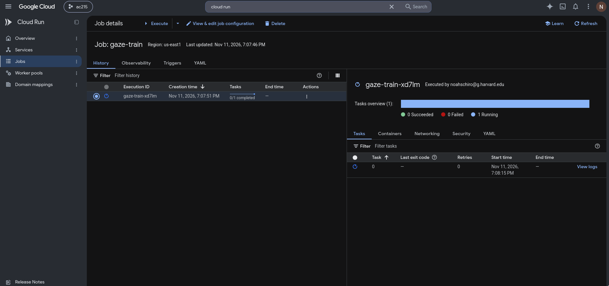
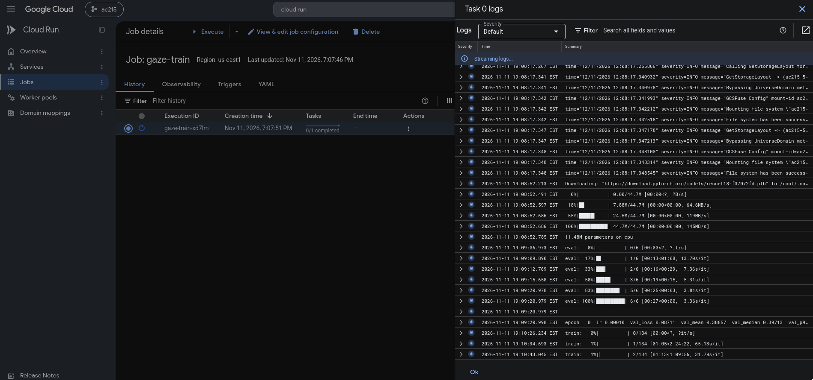
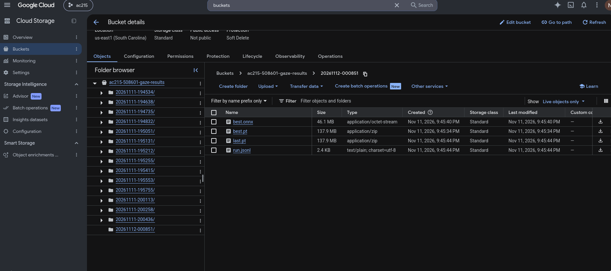
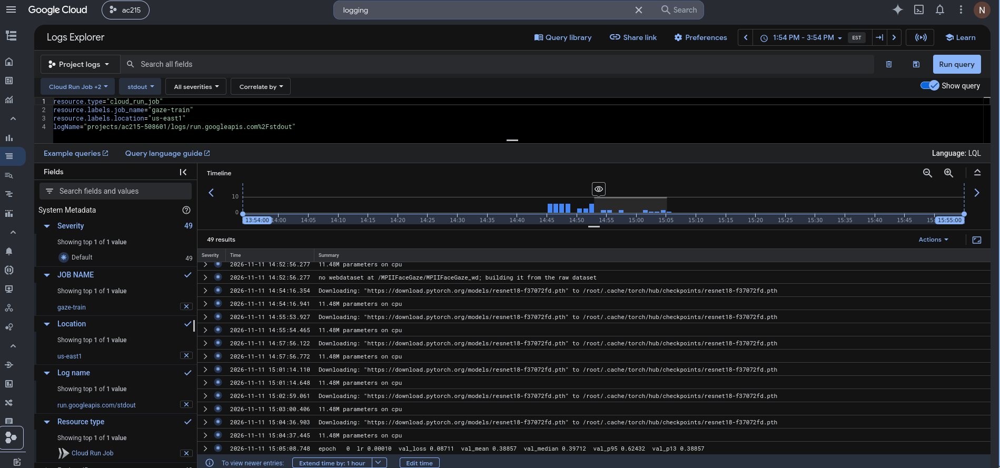
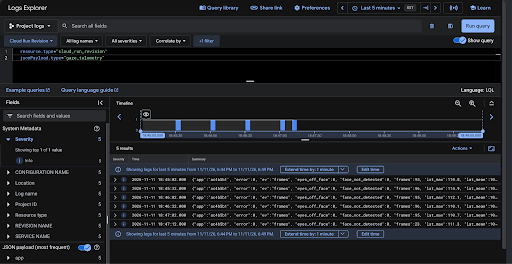
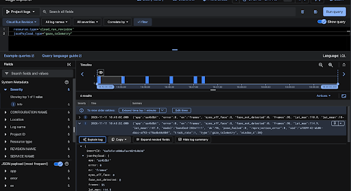
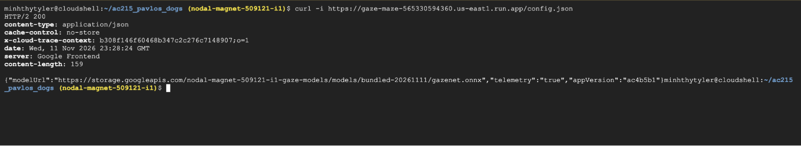

# MS3 objectives
## Advanced Training Workflows
    
* **Requirement**: Experiment tracking using Weights & Biases (W&B) or an equivalent
tool.

.

W&B runs can be found [here](https://forge.coreweave.com/wandb/noahschiro-harvard-university/gaze?nw=nwusernoahschiro).

* **Requirement**: Serverless training on Vertex AI (or documented equivalent), with
at least one training run logged and reproducible (one successful run is sufficient;
multiple experiments are encouraged but not required).

This is possible by using the script in `./model/deploy.sh`. There are a few one
time setup CLI calls you need to make, you need to move your data up into a
bucket, specify where your data is, and where your results will go, etc. This will
always be specific to a user/project. However, the spirit of this pipeline is that
once you have configured your GCP, running a training job there should take one
command. That is the case for our project and if a new user wanted to adapt what
we have to their GCP, it would be possible for them as well.

After configuring and running `./model/deploy.sh`, you can see the job running
in Cloud Run:



You can also see the logs there:



* **Requirement**: If applicable: multi-GPU training or distributed training setup.

Not applicable in our case. The model can be trained on a single 12GB GPU.

## Serverless Deployment

* **Requirement**: Deploy your model or API using Cloud Functions or Cloud Run.

Note that our project does not require a backend API, as the model runs in the
browser. Cloud Run serves the Gaze Maze app. The browser downloads the 46 MB ONNX model
directly from a versioned, public Cloud Storage URL and runs gaze prediction
locally. This keeps the model download outside Cloud Run's 32 MiB limit for
non-streamed, non-chunked HTTP/1 responses. We can switch model versions or roll
back by changing `MODEL_URL` without rebuilding the app image.

At the end of training, `./model/deploy.sh` writes the model weights to a results
bucket. To publish a new model, copy it into the public models bucket under a new
version folder and update `MODEL_URL`.

The frontend can be deployed using the instructions in [`deploy/README.md`](../deploy/README.md).

* **Requirement**: The service should be publicly accessible or accessible to the
teaching staff (if you have concerns about public access, discuss authentication
options with your TF).

There is no backend API or service to be accessed. The frontend can be accessed
[here](https://gaze-maze-565330594360.us-east1.run.app/).

The frontend can be deployed using the instructions in `/deploy/README.md`.

* **Requirement**: Document the deployment configuration and how to redeploy.

The deployment is documented throughly in `./model/deploy.sh` but we will relay
it here:

**Prerequisites**:
* There exists a bucket with the webdataset version of our data.
* There exists an empty bucket where we can put logs and model weights.
* There exists an artifact repository that can host our training Docker container.
* There exists service account with the appropriate permissions. This service
count will be the owner of the Cloud Run.
* _(Optional)_ if you want the run to be logged to W&B, there exists a secret in
GCP which contains the W&B API key.

You'll note that each of these prerequisites are one-time tasks, and as such
it does not make sense to make them a pipeline. They are steps that are done
once at the beginning of a project and need not be repeated ever again. After
that, we have steps that we do need to be repeated:

**Pipeline**:
1. Make sure your project is set to the project where the prerequisites live.
```bash
gcloud config set project "$PROJECT_ID"
```

2. Authenticate docker with the GCP registry.
```bash
gcloud auth configure-docker "$REGION-docker.pkg.dev"
```

3. Build the training image.
```bash
docker build -t "$IMAGE" .
```

4. Push the image to the registry.
```bash
docker push "$IMAGE"
```

5. Deploy the job to Cloud Run. This is one of the most important steps.
```bash
gcloud run jobs deploy "$JOB_NAME" \
  --image "$IMAGE" \
  --region "$REGION" \
  --service-account "$SA_EMAIL" \
  --cpu 8 --memory 16Gi \
  --task-timeout=4h \
  --add-volume=" " \ # mounts the data bucket
  --add-volume=" " \ # mounts the results bucket
  --args="$TRAIN_ARGS"
```

Note that through `TRAIN_ARGS`, we can run any kind of job we want. We can also
configure things like W&B or where our logs go and what format they live in.
This step only configures the job. It does not run it.

6. Run the job.
```bash
gcloud run jobs execute "$JOB_NAME" --region "$REGION"
```

This executes the job. Technically, we only need to do these last two steps for
the pipeline, but by rebuilding and deploying our docker container on every run, we
ensure that any updates to our training code is reflected in the run. Take note
that the training container handles preprocessing, training, evaluation, and 
places our model weights in a place that is consumable by the future CDN.

Once that job completes, you will see the run artifacts populate in your results
bucket:



The frontend can be run using the instructions in `/deploy/README.md`.

## ML Workflows with Vertex AI
* **Requirement**: At least one automated ML pipeline or workflow using Vertex AI
Pipelines or equivalent.

The training job detailed above.

* **Requirement**: Workflow should cover data preprocessing, model training,
and/or evaluation steps.

The training container handles preprocessing, training, evaluation, and 
places our model weights in a place that is consumable by the future CDN.
Launching it to cloud run and letting it run there handles everything for
us.

## Production Monitoring
* **Requirement**: Basic monitoring in place: logging, error tracking, and/or
performance metrics (at minimum, implement logging with Cloud Logging or
equivalent and document how to access logs).

GCP can do a lot of this for us since Cloud Logging exists. This is accessible
in Cloud Run by clicking "view logs." It looks like this:


Alternatively, you can go into the Logging module in GCP. Here, they have a
query language that lets you filter down to the Run Job of interest:



If you aren't a fan of GUIs, you can also use the `gcloud` CLI:

```bash
gcloud logging read <LQL query> 
```

LQL is a query langauge for logs in GCP. To see the appropriate query
for our Job, see the screenshot of the cloud logging.

Of course, another option is to access W&B, if you chose to use that.

* **Requirement**: Document what is being monitored and how to access logs or
dashboards.

Any argument that is passed into the training script is logged
* `batch_size`: batch size
* `checkpoint_dir`: where to save model weights
* `crop_jitter`: data augmentation
* `data_root`: where is the dataset?
* `dataset`: which dataset to train on (we have 2)
* `device`: which accelerator to use
* `dropout`: how much dropout?
* `epochs`: how many epochs to train for
* `flip`: data augmentation
* `lr`: what learning rate to use
* `lr_schedule`: what lr scheduler to use
* `no_eyes`: do not use eye crops
* `no_pretrained`: do not use imagenet weights
* `output_mode`: label selection (we have 2)
* `patience`: end early if no improvement in $N$ epochs
* `photometric_jitter`: data augmentation
* `resume`: resume from a checkpoint?
* `seed`: PRNG seed
* `test`: test set (which participant?)
* `val`: validation set (which participant?)
* `wandb`: wandb project
* `weight_decay`: weight decay
* `weights`: if fine-tuning previous weights, where are they?
* `workers`: cpu workers

Evaluation metrics and training metrics are also logged every epoch.
* `val_p95`: error for the 95th percentile
* `val_per_person`: error per person (some people do worse than others)
* `val_median`: median error
* `val_mean`: mean error
* `val_loss`: average loss
* `train_loss`: average loss
* `seconds`: how long to do the epoch?
* `lr`: learning rate (due to the learning rate scheduler)

At the end of a run, we also log:

* `best_val_mean`: best validation mean in the whole run
* `best_val_median`: best validation median in the whole run
* `lr`: ending learning rate
* `test_count`: how many observations are in the test set
* `test_loss`: test loss
* `test_mean`: test mean error
* `test_mean_calibrated`: same but with ridge regression (if used)
* `test_median`: test median error
* `test_median_calibrated`: same but with ridge regression (if used)
* `test_p95`: test error for the 95th percentile
* `test_p95_calibrated`: same but with ridge regression (if used)
* `train_loss`: test loss

These logs can be found either in GCP, via `gcloud` CLI, or in W&B

The deployed Gaze Maze website sends summaries of gaze tracking to Cloud Logging. 
To find them, open **Logs Explorer** in the app's Google Cloud project `nodal-magnet-509121-i1` and
run this filter:

```text
resource.type="cloud_run_revision"
resource.labels.service_name="gaze-maze"
jsonPayload.type="gaze_telemetry"
```



*Logs Explorer shows multiple reports from the deployed app.*



*In this reporting window, 100% of frames tracked successfully, and average
processing time was about 108 ms per frame. Each report includes the model
version, so we can compare tracking rates and latency across versions during
actual gameplay. Webcam images stay in the browser.*

## Working API

Not applicable for our project. The frontend can be accessed
[here](https://gaze-maze-565330594360.us-east1.run.app/).

Instructions for deploying that frontend can be found at `./deploy/README.md`

# Deliverables:

## Code Submission
* **Requirement**: All code for the components above, well-organized and documented. 

This repo. :)

* **Requirement**: Any additions or modifications relative to Milestone 2 must be
highlighted in the README.md file. 

None.

## README.md

* **Requirement**: How to reproduce training runs (experiment tracking setup,
Vertex AI job configuration).

A lot of the instructions can be found above, but broadly, configure your GCP to have the right
names, modify the `./model/deploy.sh` script to point at your resources, run it.

* **Requirement**: How to deploy the service (Cloud Functions/Cloud Run config
and commands).

Run `./model/deploy.sh` for the training. Follow the instructions in
`./deploy/README.md` for the frontend

* **Requirement**: How to run the ML pipeline.

Run `./model/deploy.sh`

* **Requirement**: How to access the API (endpoints and example calls).

None. The frontend is accessible here: https://gaze-maze-565330594360.us-east1.run.app/. You
access it from a supported browser (see `ui/README.md` for supported browsers).

## Evidence of a Running System

Include screenshots showing:
* **Requirement**: A training run tracked in W&B (or equivalent).

See above screenshot.

* **Requirement**: The deployed service responding to a request (e.g., a curl call
screenshot showing the response).

```bash
curl https://gaze-maze-565330594360.us-east1.run.app/
<!doctype html>
<html lang="en">
  <head>
    <meta charset="UTF-8" />
    <link rel="icon" type="image/svg+xml" href="/favicon.svg" />
    <meta name="viewport" content="width=device-width, initial-scale=1.0" />
    <title>Gaze Maze</title>
    <script type="module" crossorigin src="/assets/index-DlhaK6yu.js"></script>
    <link rel="stylesheet" crossorigin href="/assets/index-Cv3DoTlt.css">
  </head>
  <body>
    <div id="root"></div>
  </body>
</html>
```
Requesting `/config.json` returns HTTP 200 and tells the browser where to download the gaze model:



*The deployed Cloud Run service returns HTTP 200 for `/config.json`, which
tells the browser where to download the gaze model.*
