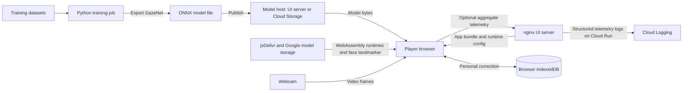
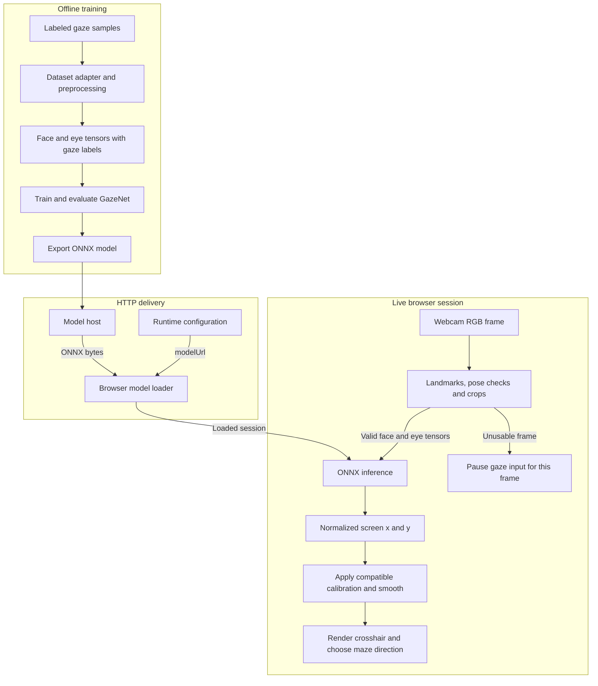
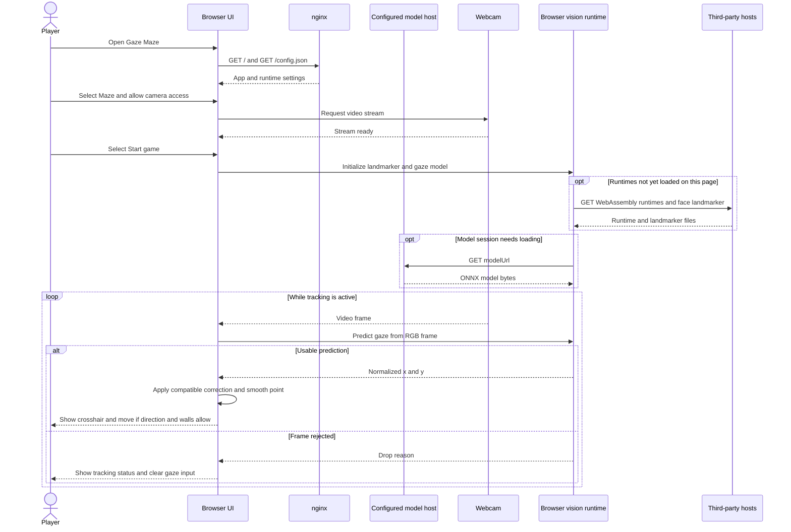
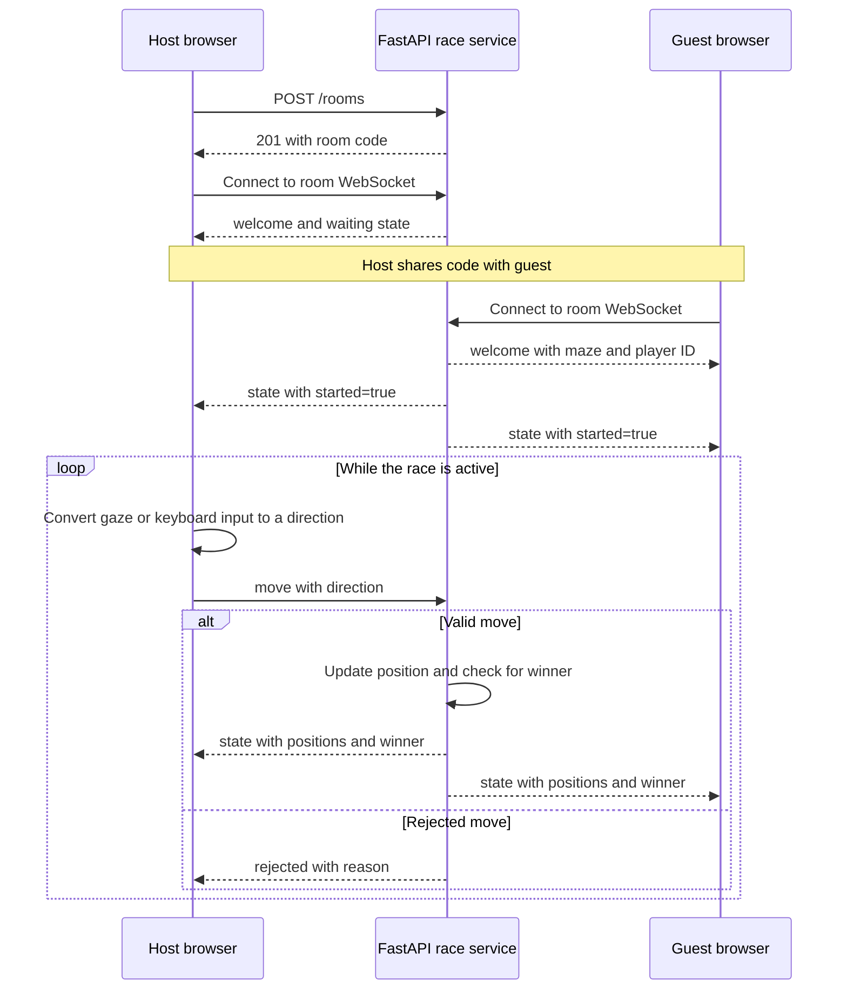

# Gaze Maze · Application Design

**MS4 working draft, November 26, 2026.** Sections 1–7 describe the single-player baseline at `e495cac`. Section 8 records the race backend, gaze controls and deployment changes under review. The final MS4 integration and historical mockup images are pending.

Gaze Maze lets a player guide Pavlos through a maze by looking toward the desired direction. A webcam supplies images, a gaze model predicts a point on the screen, and the game converts that point into a movement command. The player can personalize the mapping with a short calibration. The central architectural decision is where prediction runs: the browser downloads the trained model and processes the player's camera frames locally.

## 1. Interface and primary user flows

The MS1 proposal specified the interface in text, with one accompanying diagram, and did not include drawn wireframes. Its *Application Mock Design* section describes two screens:

> **User Interface 1:** Calibration screen. The user is guided through a set of on-screen points; a frame is captured at each one and used to fit the per-user model.
>
> **User Interface 2:** Maze screen. The user steers a ball to the exit using gaze alone, with a win condition and a completion time.

*Figure 1. The diagram from the MS1 mock design section. The browser-side pipeline was built as planned. Delivery changed: nginx on Cloud Run serves the app and Cloud Storage serves the model (§2).* [Proposal source](../proposal/main.typ)

The implemented game replaces the ball with Pavlos, gives the destination a visible marker, a piece of cheese, and offers a new maze after a win.

*Figure 2. The running MS2 maze at localhost:8080. The board already showed the player and destination. At this stage the player used the keyboard; gaze control was still in development.* [MS2 report](https://github.com/NoahSchiro/ac215_pavlos_dogs/blob/2d4bebd69721bb69e5306ad6d8047161601d4182/MS2_deliverables/MS2_report.md)

### First-time player: calibrate and play

| Screen | What the player does | What the application shows or does |
| --- | --- | --- |
| Home | Selects **Calibration** and grants camera access. | The calibration screen reports camera readiness. If access fails, the player can retry or return home. |
| Calibration | Selects **Begin**, looks at each of nine targets, and presses Space at each target. | The screen enters full screen when available. Each capture collects three frames paired with a known screen position. Escape cancels the session. |
| Home, after capture | Waits for **Calibration ready**. | The home screen shows processing progress while the browser predicts gaze for the samples, fits a ridge correction and saves it locally. The player can optionally select **Validate calibration** for a four-point accuracy check. |
| Maze | Selects **Maze**, waits for camera readiness, then selects **Start game**. | A status line reports model loading and tracking. A crosshair shows the estimated gaze point. Looking outside the central zone selects a direction. Walls constrain movement. |
| Victory | Reaches the cheese and selects **Try Another Maze**. | The game displays **You found the cheese!** and offers another board. |

**Direct play and recovery.** A player can go directly from **Home → Maze → Start game**. The status line indicates whether a personal correction is active. After a page reload, **Verify saved camera** enables reuse of a compatible calibration. If the player resizes the calibrated window, gaze control pauses and the crosshair disappears. Restoring the original size and full-screen mode lets tracking resume. Arrow keys also control movement. [UI guide](../ui/README.md) · [Screen transitions](../ui/src/App.tsx) · [Maze controls and victory state](../ui/src/maze/Maze.tsx)

## 2. Solution architecture

The system has two distinct lifecycles. Training produces a reusable model. A play session reads that model and fits an optional correction for one player. Starting a game requires the serving and browser components, plus three third-party downloads described below.

For local serving, Docker Compose maps port 8080 to the UI container. nginx serves the web bundle, configuration and bundled model path. In the MS3 cloud configuration, Cloud Run serves the app and the browser retrieves a versioned model from Cloud Storage. This lets the team change the model URL independently of the UI build. Webcam frames and per-frame gaze coordinates stay on the device. The UI image enables telemetry by default (`TELEMETRY=true`), and it reports aggregate tracking outcomes and timings. The Vite dev server has no `/config.json`, so telemetry is off there. [Compose services](../docker-compose.yml) · [Deployment configuration](../deploy/README.md) · [Telemetry implementation](../ui/src/telemetry.ts)

**Third-party downloads.** On first use the browser also fetches three files that the project does not host. The ONNX Runtime Web and MediaPipe WebAssembly runtimes come from jsDelivr, each pinned to the package version the app was built against. The MediaPipe face landmarker model comes from Google's public model storage, the same file the Python pipeline uses. OpenCV is compiled into the app bundle. A player therefore needs network access to those two hosts as well as to the UI server and the model host. [Landmarker loader](../ui/src/vision/utils.ts) · [ONNX Runtime loader](../ui/src/vision/model.ts)

## 3. Technical architecture

| Responsibility | Implementation and design choice |
| --- | --- |
| Train and export | Python dataset adapters prepare labeled samples. PyTorch trains GazeNet and the export module produces ONNX weights. A named tensor interface connects the Python pipeline to the web runtime. |
| Serve and configure | Vite builds the React and TypeScript application. nginx reads deployment settings at startup and exposes them through runtime configuration. The browser caches the parsed configuration for the page. |
| Acquire and preprocess frames | The camera hook manages the media stream. A canvas converts a gameplay frame to RGB. MediaPipe facial landmarks and OpenCV-based geometry support face and eye cropping. Normalization matches the training pipeline. |
| Run inference | ONNX Runtime Web uses its WebAssembly backend. The loader validates the model's input and output names and shares a model session across calls. A failed load clears the cached promise so a later attempt can retry. |
| Personalize predictions | Ridge regression fits the relationship between predicted gaze and known target positions. IndexedDB holds the fitted correction and compatibility information. Captured calibration images are released after processing. |
| Translate gaze into movement | The game applies a compatible correction, then a Kalman filter. The crosshair and direction logic consume the same smoothed point. Inside the center zone the player stays still. Outside it, the dominant axis determines the direction. |

The browser and Python implementations share a preprocessing contract across languages. Fixture-based parity tests compare browser preprocessing and model results with reference outputs. These checks matter because a crop or normalization mismatch can change the predicted gaze even when the exported weights load successfully. [Vision parity tests](../ui/src/vision/parity.test.ts) · [Model tests](../ui/src/vision/model.test.ts) · [Gameplay direction logic](../ui/src/maze/gazeDirection.ts)

## 4. End-to-end data flow

The repository contains adapters for MPIIFaceGaze and GazeCapture. The local training service shown in Compose unpacks MPIIFaceGaze. For a live frame, the model receives three float32 tensors named `face`, `left_eye` and `right_eye`. Its `prediction` output has shape `[1, 2]` for a single frame, representing horizontal and vertical screen fractions. A frame with no detected face yields a tracking status and no direction. Model delivery crosses the HTTP boundary once per loaded session; frame predictions return directly to the frontend in memory. [Dataset adapters](../model/src/data/) · [Model export](../model/src/training/export.py) · [Browser inference](../ui/src/vision/model.ts)

## 5. Sequence diagram: start a maze and steer

This sequence follows a player starting from a fresh page. A saved, verified correction can be applied during the frame loop. If calibration already loaded the model on this page, gameplay reuses that session.

[Maze screen lifecycle](../ui/src/maze/MazeScreen.tsx) · [Single-frame prediction and error handling](../ui/src/maze/predictFrame.ts)

## 6. API and runtime contracts

The MS3 baseline exposes the following HTTP interactions. Gaze estimation has a separate in-process interface described below. Examples show representative values.

| Caller and purpose | Method and resource | Request | Response |
| --- | --- | --- | --- |
| Browser loads runtime settings | `GET /config.json` | Empty body | `200` JSON. The local Compose container returns `{"modelUrl":"/models/gazenet.onnx","telemetry":"true","appVersion":"dev"}`. The browser parses the telemetry flag from its string form and uses defaults, with telemetry off, if configuration is unavailable. |
| Browser loads model | `GET {modelUrl}` | Empty body. The default path is `/models/gazenet.onnx`. | Binary ONNX weights on success. A missing local file returns `404`; a model-load failure surfaces in the UI. |
| Health probe checks serving process | `GET /healthz` | Empty body | `200 text/plain` with `ok` followed by a newline. |
| Browser reports telemetry when enabled | `POST /t` | Query fields identify the event, page session, model and app version. Example: `/t?v=1&ev=start&sid=example&model=bundled&app=dev`. A frame summary also carries counts, rates and latency. | `204` with an empty body. nginx writes a structured log entry. |

**Inference contract.** The browser calls `predictGaze(landmarker, model, image, intrinsics)`. A successful call resolves to a screen fraction such as `{"x":0.72,"y":0.48}`. A rejected frame resolves to a reason such as `face_not_detected`. The gameplay caller uses that result to pause tracking for the frame. These calls run locally throughout play. [HTTP handlers](../ui/nginx/default.conf.template) · [Configuration parser](../ui/src/config.ts) · [Model interface](../ui/src/vision/model.ts)

## 7. Code organization

The repository separates frontend, backend and data science work by top-level directory.

| Layer | Directory | Contents |
| --- | --- | --- |
| Frontend | [ui/](../ui/) | The React and TypeScript application in `ui/src/`, with unit tests beside the source and a browser smoke test in `ui/e2e/`. |
| Backend and serving | [ui/nginx/](../ui/nginx/), [deploy/](../deploy/) | At the baseline the only server-side code is the nginx configuration, which serves the app, runtime settings, health check and telemetry route. The race PR adds `race_server/`, a FastAPI service with its own tests and Dockerfile (§8). |
| Data science | [model/](../model/), [data/](../data/) | Dataset adapters, training, evaluation and ONNX export in `model/src/`, tests in `model/tests/`, and local dataset inputs in `data/`. |

The next table goes one level deeper.

| Area | Where to look | Responsibility |
| --- | --- | --- |
| Screen navigation and user tasks | [App.tsx](../ui/src/App.tsx), [home](../ui/src/home/), [calibration](../ui/src/calibration/), [maze](../ui/src/maze/) | Coordinate screen transitions, calibration capture and storage, and game state. |
| Client-side vision | [vision](../ui/src/vision/), [gaze](../ui/src/gaze/) | Convert images to predictions, filter coordinates and render the crosshair. Both calibration and gameplay use the vision code. |
| Serving and deployment | [nginx](../ui/nginx/), [UI Dockerfile](../ui/Dockerfile), [deploy](../deploy/) | Serve application resources, configure HTTP routes, publish weights and configure cloud monitoring. |
| Training data and model development | [data](../data/), [dataset adapters](../model/src/data/), [training](../model/src/training/), [train.py](../model/train.py) | Store local data inputs, adapt dataset formats, train and evaluate the model, and export artifacts. |
| Local service wiring | [docker-compose.yml](../docker-compose.yml) | Defines the UI and training containers, training volumes and local UI port. |

To trace a movement from pixels to the board, start at [MazeScreen](../ui/src/maze/MazeScreen.tsx), which owns the camera and prediction loop. Follow [predictFrame](../ui/src/maze/predictFrame.ts) into [gazeCapture](../ui/src/maze/gazeCapture.ts) and the [vision model](../ui/src/vision/model.ts). On the return path, [gazeDirection](../ui/src/maze/gazeDirection.ts) maps the point to a command and [Maze](../ui/src/maze/Maze.tsx) applies the board rules.

## 8. MS4 changes under review

### Two-player race

The race branch adds **Race a friend** to the home screen. The host selects **Create race**, receives a four-letter code and waits for the second player. The second player enters the code and selects **Join**. Both see the same maze, with their opponent shown as a faded marker. The first player to reach the cheese wins. The UI also reports room errors and an opponent leaving. [Race PR #78](https://github.com/NoahSchiro/ac215_pavlos_dogs/pull/78) · [Race screen at `92d6ae8`](https://github.com/NoahSchiro/ac215_pavlos_dogs/blob/92d6ae80f8a53413ef1ec4f0aebd7beb06232c0c/ui/src/race/RaceScreen.tsx)

Each browser runs its own gaze inference and sends direction commands to a FastAPI service. The server owns the shared maze, player positions and winner. It checks walls, race status and move rate before applying a command, then broadcasts the updated state to both browsers. Camera frames and gaze coordinates stay on each player's device. Room state lives in server memory. A deployment with this layout must route both players to the same server instance. The PR records the course staff's approval to use the race service as the project's backend in place of a prediction API. [Race PR #78](https://github.com/NoahSchiro/ac215_pavlos_dogs/pull/78) · [Race state and rules at `92d6ae8`](https://github.com/NoahSchiro/ac215_pavlos_dogs/blob/92d6ae80f8a53413ef1ec4f0aebd7beb06232c0c/race_server/app/game.py)

**Race data flow.** Webcam frame → browser preprocessing → ONNX gaze prediction → browser direction command → FastAPI WebSocket → room validation and state update → both browsers render the new positions. Keyboard input enters at the direction-command step.

Either player can send moves. The sequence shows the host sending one as an example. Both browsers display the result when the server sets the winner.

### Race API and code organization

The race branch adds `raceServerUrl` to the UI server's `/config.json` response. The frontend uses the configured HTTP origin for room creation and derives a `ws://` or `wss://` URL for gameplay. The default local backend is `http://localhost:8000`. The race branch starts both local services with `docker compose up --build race-server ui`. [Runtime configuration at `92d6ae8`](https://github.com/NoahSchiro/ac215_pavlos_dogs/blob/92d6ae80f8a53413ef1ec4f0aebd7beb06232c0c/ui/src/config.ts) · [Compose at `92d6ae8`](https://github.com/NoahSchiro/ac215_pavlos_dogs/blob/92d6ae80f8a53413ef1ec4f0aebd7beb06232c0c/docker-compose.yml)

| Method and path | Request | Response or messages |
| --- | --- | --- |
| `GET /health` | Empty body | `200` with `{"status":"ok","rooms":0}` for an idle server. |
| `POST /rooms` | Empty body | `201` with a four-letter room code, e.g. `{"code":"ABCD"}`. |
| `GET /rooms/{code}` | Room code in the path | `200` with `code`, `players` (count), `started` and `winner` (player ID or `null`). Unknown rooms return `404`. |
| WebSocket `/rooms/{code}/ws` | Connect using the room code, then send JSON such as `{"type":"move","direction":"up"}`. Directions are `up`, `down`, `left` and `right`. | `welcome` contains the assigned player ID and maze geometry. `state` contains the start flag, positions keyed by player ID and the winner. `rejected` carries a move rejection reason. `opponent_left` reports a disconnect. An unknown or full room sends `error` and closes with code `4404` or `4409`, respectively. |

The frontend lives in `ui/src/race/`, with `raceClient.ts` defining the message shapes. The backend lives in `race_server/`, with `app/main.py` handling HTTP and WebSocket routing, `app/game.py` owning room state and move validation, and `app/maze.py` generating the shared maze. FastAPI serves interactive HTTP docs at `/docs`. The WebSocket message contract is documented in the race server README. [Race client at `92d6ae8`](https://github.com/NoahSchiro/ac215_pavlos_dogs/blob/92d6ae80f8a53413ef1ec4f0aebd7beb06232c0c/ui/src/race/raceClient.ts) · [FastAPI handlers at `92d6ae8`](https://github.com/NoahSchiro/ac215_pavlos_dogs/blob/92d6ae80f8a53413ef1ec4f0aebd7beb06232c0c/race_server/app/main.py) · [Race server README at `92d6ae8`](https://github.com/NoahSchiro/ac215_pavlos_dogs/blob/92d6ae80f8a53413ef1ec4f0aebd7beb06232c0c/race_server/README.md)

### Solo gaze controls and deployment

| Open PR | Effect on the design document if included in MS4 |
| --- | --- |
| [#95 Pavlos-relative gaze controls](https://github.com/NoahSchiro/ac215_pavlos_dogs/pull/95) | Solo movement uses a drive area around Pavlos. Holding a gaze point can direct him toward a reachable cell through wall-aware path selection. The calibration target gets a nearby Space prompt, and the accuracy check reports error by axis and by target. Update the solo screenshots, movement description and final step of the data flow and sequence diagrams. |
| [#96 Dynamic recentering](https://github.com/NoahSchiro/ac215_pavlos_dogs/pull/96) | This branch includes the #95 commits and adds in-game recovery for gaze drift. The player activates the recenter strip and follows a prompt to hold their gaze on Pavlos. The browser uses that known position to calculate a correction that fades with distance from the sample location. Add a recovery flow and show the correction before movement selection. |
| [#90 Simplified deployment](https://github.com/NoahSchiro/ac215_pavlos_dogs/pull/90) | The proposed nginx configuration changes the UI health route to `/health`, serves only `modelUrl` in `/config.json`, and removes the baseline telemetry route. If both this change and Race land, verify the integrated config provides `raceServerUrl` and record the actual health and telemetry routes. |
| [#81 GCP GPU training](https://github.com/NoahSchiro/ac215_pavlos_dogs/pull/81) and [#91 Docker optimizations](https://github.com/NoahSchiro/ac215_pavlos_dogs/pull/91) | Check the final training and container setup. The GPU PR adds a Cloud Run job with GPU training and Cloud Storage volumes for data and checkpoints. Update the offline training boxes, container roles and repository references to match the selected setup. |

## Material needed for the final MS4 version

| Item | What will complete the draft |
| --- | --- |
| Original MS1/MS2 wireframes | §1 now includes the MS1 mock design text and diagram and the MS2 implementation screenshot. If a slide or Figma export of drawn calibration and maze mockups exists, add it to §1 with a milestone caption. |
| MS4 screen walkthrough | Add the final home screen, a calibration target and live solo maze tracking. If Race is included, capture the lobby with a room code and an active two-player race with the opponent marker visible. If dynamic recentering is included, capture the prompt and fixation progress in the maze. A victory screenshot can illustrate the end of either flow. |
| Final integration reference | Record the final `milestone4` commit. Verify the walkthrough, health and configuration routes, and race connection against that build. If Race is included, capture a frontend room creation and a shared state update across two clients. Fold the changes that shipped into the main sections. |
