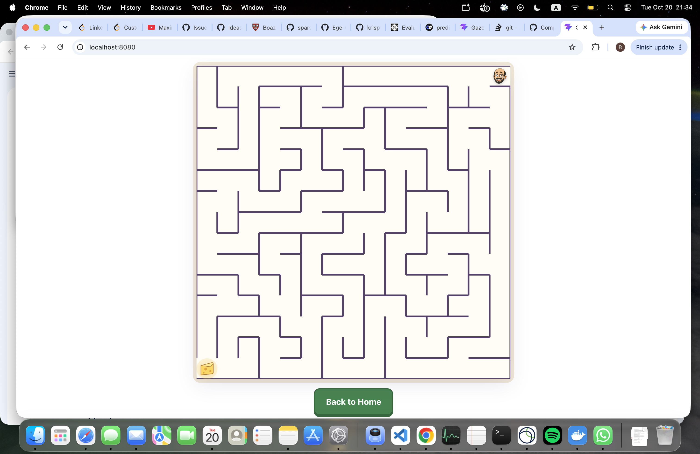
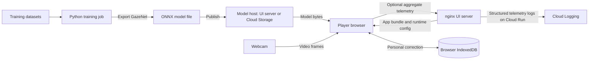
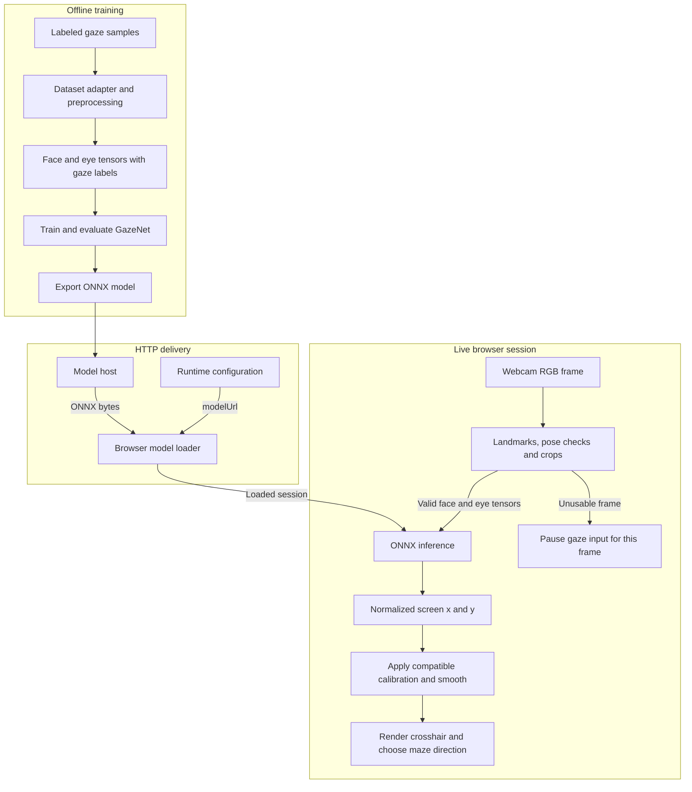
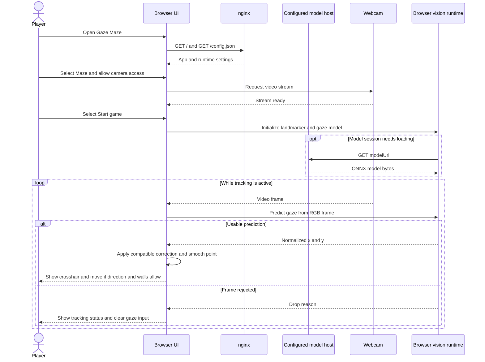

# Gaze Maze · Application Design

**MS4 working draft.** Implementation baseline: milestone3 commit `e495cac`. Final MS4 integration and historical mockup images are pending.

Gaze Maze lets a player guide Pavlos through a maze by looking toward the desired direction. A webcam supplies images, a gaze model predicts a point on the screen, and the game converts that point into a movement command. The player can personalize the mapping with a short calibration. The central architectural decision is where prediction runs: the browser downloads the trained model and processes the player's camera frames locally.

## 1. Interface and primary user flows

The original proposal described two screens. On the calibration screen, the player looks at known targets so the application can learn a personal correction. On the maze screen, the player steers toward an exit. The implemented game gives the destination a visible marker, a piece of cheese, and offers a new maze after a win. [Original application mock design](../proposal/main.typ)

*Figure 1. The running MS2 maze at localhost:8080. The board already showed the player and destination. At this stage the player used the keyboard; gaze control was still in development.* [MS2 report](https://github.com/NoahSchiro/ac215/blob/2d4bebd69721bb69e5306ad6d8047161601d4182/MS2_deliverables/MS2_report.md)

### First-time player: calibrate and play

| Screen | What the player does | What the application shows or does |
| --- | --- | --- |
| Home | Selects **Calibration** and grants camera access. | The calibration screen reports camera readiness. If access fails, the player can retry or return home. |
| Calibration | Selects **Begin**, looks at each of nine targets, and presses Space at each target. | The screen enters full screen when available. Each capture collects three frames paired with a known screen position. Escape cancels the session. |
| Home, after capture | Waits for **Calibration ready**. | The home screen shows processing progress while the browser predicts gaze for the samples, fits a ridge correction and saves it locally. The player can optionally select **Validate calibration** for a four-point accuracy check. |
| Maze | Selects **Maze**, waits for camera readiness, then selects **Start game**. | A status line reports model loading and tracking. A crosshair shows the estimated gaze point. Looking outside the central zone selects a direction. Walls constrain movement. |
| Victory | Reaches the cheese and selects **Try Another Maze**. | The game displays **You found the cheese!** and offers another board. |

**Direct play and recovery.** A player can go directly from **Home → Maze → Start game**. The status line indicates whether a personal correction is active. After a page reload, **Verify saved camera** enables reuse of a compatible calibration. If the player resizes the calibrated window, gaze control pauses and the crosshair disappears. Restoring the original size and full-screen mode lets tracking resume. Arrow keys also control movement. [UI guide](../ui/README.md) · [Screen transitions](../ui/src/App.tsx) · [Maze controls and victory state](../ui/src/maze/Maze.tsx)

## 2. Solution architecture

The system has two distinct lifecycles. Training produces a reusable model. A play session reads that model and fits an optional correction for one player. Starting a game only requires the serving and browser components.

For local serving, Docker Compose maps port 8080 to the UI container. nginx serves the web bundle, configuration and bundled model path. In the MS3 cloud configuration, Cloud Run serves the app and the browser retrieves a versioned model from Cloud Storage. This lets the team change the model URL independently of the UI build. Webcam frames and per-frame gaze coordinates stay on the device. When enabled, telemetry reports aggregate tracking outcomes and timings. [Compose services](../docker-compose.yml) · [Deployment configuration](../deploy/README.md) · [Telemetry implementation](../ui/src/telemetry.ts)

## 3. Technical architecture

| Responsibility | Implementation and design choice |
| --- | --- |
| Train and export | Python dataset adapters prepare labeled samples. PyTorch trains GazeNet and the export module produces ONNX weights. A named tensor interface connects the Python pipeline to the web runtime. |
| Serve and configure | Vite builds the React and TypeScript application. nginx reads deployment settings at startup and exposes them through runtime configuration. The browser caches the parsed configuration for the page. |
| Acquire and preprocess frames | The camera hook manages the media stream. A canvas converts a gameplay frame to RGB. MediaPipe facial landmarks and OpenCV-based geometry support face and eye cropping. Normalization matches the training pipeline. |
| Run inference | ONNX Runtime Web uses its WebAssembly backend. The loader validates the model's input and output names and shares a model session across calls. A failed load clears the cached promise so a later attempt can retry. |
| Personalize predictions | Ridge regression fits the relationship between predicted gaze and known target positions. IndexedDB holds the fitted correction and compatibility information. Captured calibration images are released after processing. |
| Translate gaze into movement | The game applies a compatible correction, then a Kalman filter. The crosshair and direction logic consume the same smoothed point. Inside the center zone the player stays still. Outside it, the dominant axis determines the direction. |

The browser and Python implementations share a preprocessing contract across languages. Fixture-based parity tests compare browser preprocessing and model results with reference outputs. These checks matter because a crop or normalization mismatch can change the predicted gaze even when the exported weights load successfully. [Vision parity tests](../ui/src/vision/parity.test.ts) · [Model tests](../ui/src/vision/model.test.ts) · [Gameplay direction logic](../ui/src/maze/gazeDirection.ts)

## 4. End-to-end data flow

The repository contains adapters for MPIIFaceGaze and GazeCapture. The local training service shown in Compose unpacks MPIIFaceGaze. For a live frame, the model receives three float32 tensors named `face`, `left_eye` and `right_eye`. Its `prediction` output has shape `[1, 2]` for a single frame, representing horizontal and vertical screen fractions. A frame with no detected face yields a tracking status and no direction. Model delivery crosses the HTTP boundary once per loaded session; frame predictions return directly to the frontend in memory. [Dataset adapters](../model/src/data/) · [Model export](../model/src/training/export.py) · [Browser inference](../ui/src/vision/model.ts)

## 5. Sequence diagram: start a maze and steer

This sequence follows a player starting from a fresh page. A saved, verified correction can be applied during the frame loop. If calibration already loaded the model on this page, gameplay reuses that session.

[Maze screen lifecycle](../ui/src/maze/MazeScreen.tsx) · [Single-frame prediction and error handling](../ui/src/maze/predictFrame.ts)

## 6. API and runtime contracts

The MS3 baseline exposes the following HTTP interactions. Gaze estimation has a separate in-process interface described below. Examples show representative values.

| Caller and purpose | Method and resource | Request | Response |
| --- | --- | --- | --- |
| Browser loads runtime settings | `GET /config.json` | Empty body | `200` JSON, e.g. `{"modelUrl":"/models/gazenet.onnx","telemetry":"false","appVersion":"dev"}`. The browser parses the telemetry flag and uses defaults if configuration is unavailable. |
| Browser loads model | `GET {modelUrl}` | Empty body. The default path is `/models/gazenet.onnx`. | Binary ONNX weights on success. A missing local file returns `404`; a model-load failure surfaces in the UI. |
| Health probe checks serving process | `GET /healthz` | Empty body | `200 text/plain` with `ok` followed by a newline. |
| Browser reports telemetry when enabled | `POST /t` | Query fields identify the event, page session, model and app version. Example: `/t?v=1&ev=start&sid=example&model=bundled&app=dev`. A frame summary also carries counts, rates and latency. | `204` with an empty body. nginx writes a structured log entry. |

**Inference contract.** The browser calls `predictGaze(landmarker, model, image, intrinsics)`. A successful call resolves to a screen fraction such as `{"x":0.72,"y":0.48}`. A rejected frame resolves to a reason such as `face_not_detected`. The gameplay caller uses that result to pause tracking for the frame. These calls run locally throughout play. [HTTP handlers](../ui/nginx/default.conf.template) · [Configuration parser](../ui/src/config.ts) · [Model interface](../ui/src/vision/model.ts)

## 7. Code organization

| Area | Where to look | Responsibility |
| --- | --- | --- |
| Screen navigation and user tasks | [App.tsx](../ui/src/App.tsx), [home](../ui/src/home/), [calibration](../ui/src/calibration/), [maze](../ui/src/maze/) | Coordinate screen transitions, calibration capture and storage, and game state. |
| Client-side vision | [vision](../ui/src/vision/), [gaze](../ui/src/gaze/) | Convert images to predictions, filter coordinates and render the crosshair. Both calibration and gameplay use the vision code. |
| Serving and deployment | [nginx](../ui/nginx/), [UI Dockerfile](../ui/Dockerfile), [deploy](../deploy/) | Serve application resources, configure HTTP routes, publish weights and configure cloud monitoring. |
| Training data and model development | [data](../data/), [dataset adapters](../model/src/data/), [training](../model/src/training/), [train.py](../model/train.py) | Store local data inputs, adapt dataset formats, train and evaluate the model, and export artifacts. |
| Local service wiring | [docker-compose.yml](../docker-compose.yml) | Defines the UI and training containers, training volumes and local UI port. |

To trace a movement from pixels to the board, start at [MazeScreen](../ui/src/maze/MazeScreen.tsx), which owns the camera and prediction loop. Follow [predictFrame](../ui/src/maze/predictFrame.ts) into [gazeCapture](../ui/src/maze/gazeCapture.ts) and the [vision model](../ui/src/vision/model.ts). On the return path, [gazeDirection](../ui/src/maze/gazeDirection.ts) maps the point to a command and [Maze](../ui/src/maze/Maze.tsx) applies the board rules.

## Material needed for the final MS4 version

| Item | What will complete the draft |
| --- | --- |
| Original MS1/MS2 wireframes | Add the original calibration and maze mockups with milestone captions to §1. A slide or Figma export containing both is sufficient. The archived MS2 implementation screenshot is already included. If the only early design was the proposal text, record that provenance. |
| MS4 screen walkthrough | Add screenshots of the final home screen, a calibration target, and live maze tracking with the status and crosshair visible. A victory screenshot can illustrate the end of the flow. |
| Final integration reference | Record the team's MS4 branch or PR and final commit. Verify the walkthrough and HTTP contracts against that build. If a backend API is introduced, update the diagrams and include one demonstrated frontend request and response. |
